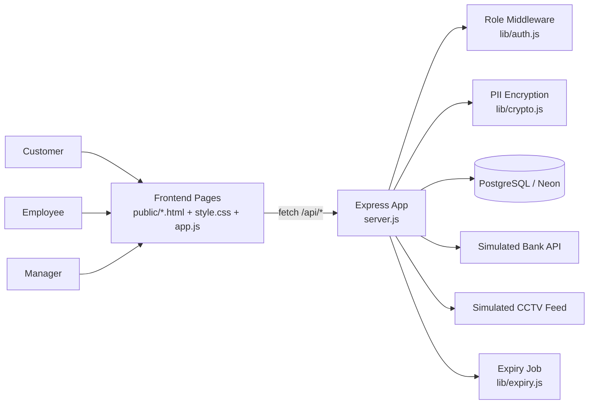
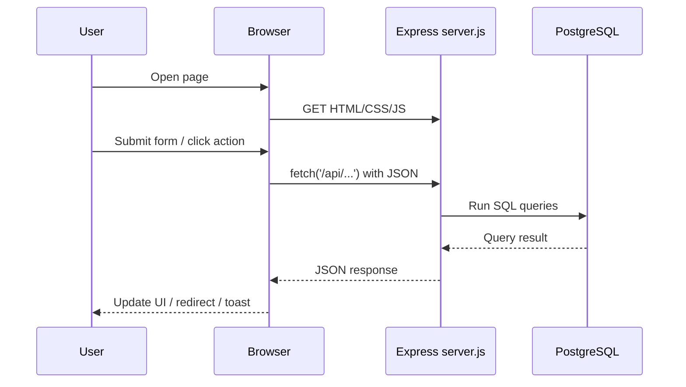
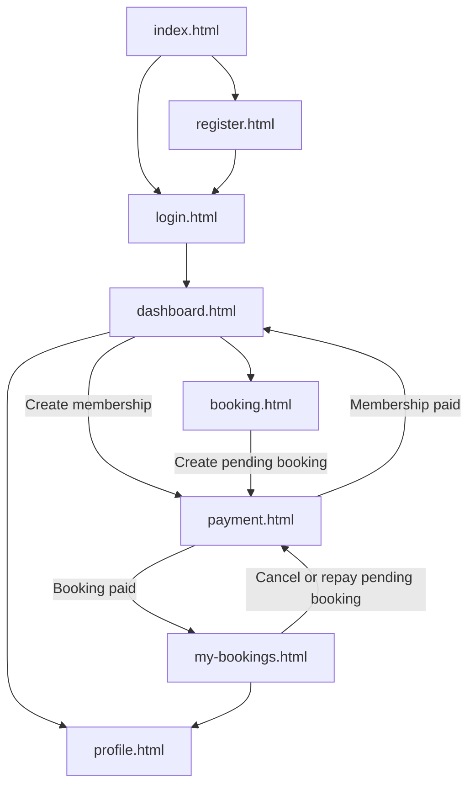
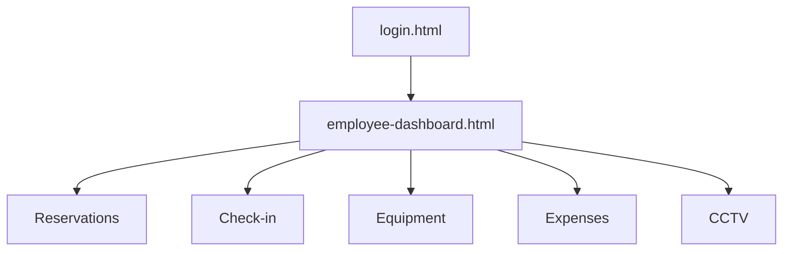
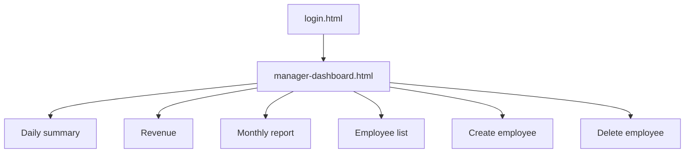
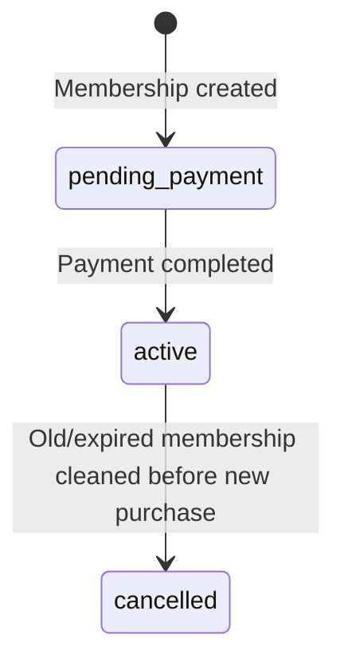
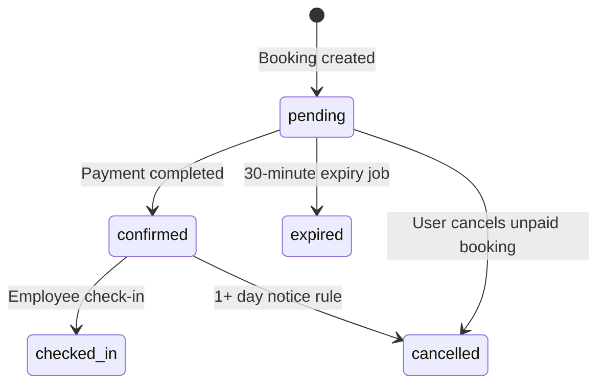
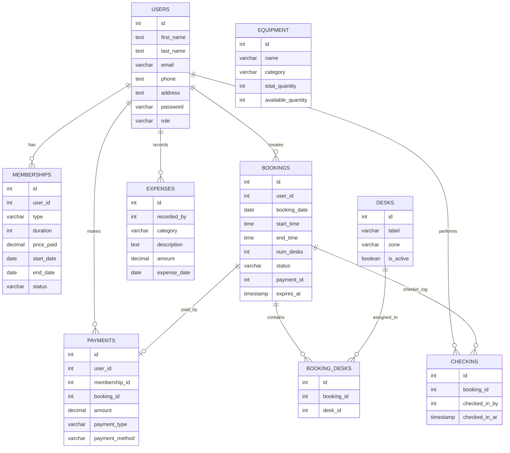
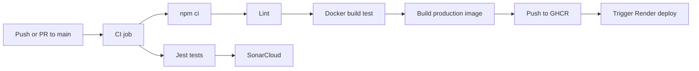

# SpaceHub Project Map

## Purpose

This document explains how the SpaceHub project works as a running system:

- what the major parts are
- how users move through the application
- how the frontend talks to the backend
- how data flows through the database
- what the runtime and deployment dependencies are

The analysis below reflects the code that is currently wired in the repository, centered around `implementations/server.js`.

---

## 1. System Summary

SpaceHub is a monolithic web application for a co-working space.

It consists of:

- a static frontend in `implementations/public/`
- a single Node.js/Express backend in `implementations/server.js`
- a PostgreSQL database
- utility modules for role checking, encryption, and booking expiry
- CI/CD automation through GitHub Actions, Docker, GHCR, and Render

This is not a separate frontend app plus separate API service. The same Express server both serves the static pages and exposes the JSON API.

---

## 2. High-Level Architecture

### Main idea

- Users interact with HTML pages.
- Those pages call backend endpoints using `fetch(...)`.
- The backend applies business rules and persists data in PostgreSQL.
- Sensitive personal data is encrypted before storage.
- A background job expires unpaid bookings.

---

## 3. Repository Map

| Path | Role in the system |
|---|---|
| `.github/workflows/workflow.yml` | CI/CD pipeline |
| `designs/Emerald_D1_Design.md` | design explanation and C4 diagrams |
| `implementations/server.js` | main backend entry point and API |
| `implementations/lib/auth.js` | role-based access control middleware |
| `implementations/lib/crypto.js` | AES encryption/decryption for PII |
| `implementations/lib/expiry.js` | background expiry job for unpaid bookings |
| `implementations/public/` | all browser pages and frontend logic |
| `implementations/server.test.js` | integration-style API tests |
| `implementations/Dockerfile` | production container image |
| `README.md` | project overview and usage instructions |

---

## 4. Runtime Request Flow

### What ties pages together

- `sessionStorage.user`
  - stores the logged-in user object returned by `/api/login`
- `sessionStorage.pendingPayment`
  - stores temporary handoff data from membership or booking pages into `payment.html`

This means the frontend uses browser session state, not server-side sessions or JWTs.

---

## 5. Frontend Pages and Their Responsibilities

| Page | Responsibility | Main backend calls |
|---|---|---|
| `index.html` | landing page | none |
| `register.html` | create account | `POST /api/register` |
| `login.html` | authenticate and redirect by role | `POST /api/login` |
| `dashboard.html` | customer membership dashboard | `GET /api/membership/:userId`, `POST /api/membership` |
| `booking.html` | check desk availability and create booking | `GET /api/bookings/availability`, `POST /api/bookings` |
| `payment.html` | complete membership or booking payment | `POST /api/membership/:membershipId/pay`, `POST /api/bookings/:bookingId/pay` |
| `my-bookings.html` | list customer bookings, cancel, continue payment | `GET /api/bookings/user/:userId`, `POST /api/bookings/:bookingId/cancel` |
| `profile.html` | display current user info from session | none |
| `employee-dashboard.html` | employee operations | employee reservation, check-in, equipment, expenses, CCTV endpoints |
| `manager-dashboard.html` | manager analytics and employee management | summary, revenue, report, employee CRUD endpoints |

---

## 6. User Flows

### Customer flow

### Employee flow

### Manager flow

---

## 7. Backend Business Logic

### Registration and login

1. User submits registration details.
2. Server validates required fields.
3. Password is hashed with `bcryptjs`.
4. PII fields are encrypted with `lib/crypto.js`.
5. User is inserted into `users`.
6. Login verifies email and password.
7. Server decrypts PII before returning the user object.
8. Frontend stores the user object in `sessionStorage`.

### Membership flow

1. Customer selects membership type and duration on `dashboard.html`.
2. `POST /api/membership` creates a `pending_payment` membership.
3. Frontend stores payment handoff data in `sessionStorage.pendingPayment`.
4. `payment.html` submits payment using one of three methods.
5. `POST /api/membership/:membershipId/pay` inserts a payment record.
6. Membership status changes to `active`.

### Booking flow

1. Customer checks availability by date.
2. Server calculates desk occupancy across overlapping time slots.
3. Booking creation requires an active membership.
4. `POST /api/bookings` creates a `pending` booking and reserves desks.
5. Booking gets an `expires_at` timestamp 30 minutes in the future.
6. Customer is redirected to `payment.html`.
7. `POST /api/bookings/:bookingId/pay` creates a payment and changes booking to `confirmed`.
8. Employee check-in later changes booking to `checked_in`.

### Employee operations

- view reservations by date
- check in customers
- update equipment quantities
- record operational expenses
- view simulated CCTV status

### Manager operations

- view daily summary metrics
- view daily or monthly revenue breakdown
- generate monthly income report from payments and expenses
- create, list, update, and delete employee accounts

---

## 8. State Transitions

### Membership status

### Booking status

---

## 9. Data Model

### Tables created during startup

- `users`
- `memberships`
- `payments`
- `desks`
- `bookings`
- `booking_desks`
- `equipment`
- `expenses`
- `checkins`

The server also seeds:

- 50 desks
- equipment inventory
- a default manager account

---

## 10. Dependency Map

### Runtime dependencies

| Package | Purpose |
|---|---|
| `express` | server and static file hosting |
| `postgres` | PostgreSQL client used by `server.js` |
| `bcryptjs` | password hashing |
| `dotenv` | environment variable loading |

### Dev/test dependencies

| Package | Purpose |
|---|---|
| `jest` | test runner |
| `supertest` | API endpoint testing |

### Internal code dependencies

| File | Used for |
|---|---|
| `implementations/lib/auth.js` | role checks on employee and manager routes |
| `implementations/lib/crypto.js` | encrypting/decrypting personal data |
| `implementations/lib/expiry.js` | expiring unpaid bookings |
| `implementations/public/app.js` | shared browser helpers |

### External or simulated dependencies

| Dependency | Type | Purpose |
|---|---|---|
| PostgreSQL / Neon | real | persistent application storage |
| bank transfer flow | simulated | delayed payment processing |
| CCTV feed | simulated | employee monitoring display |
| GHCR | real | container image registry |
| Render | real | deployment target |

---

## 11. Deployment and Delivery Flow

### Pipeline behavior

- pushes and pull requests to `main` trigger CI
- CI installs dependencies, lints, and validates Docker build
- SonarCloud runs after CI and uses test coverage
- pushes to `main` also build and publish the production image
- Render deployment is triggered through a deploy hook

---

## 12. Security and Access Model

| Concern | Current implementation |
|---|---|
| password storage | bcrypt hash |
| personal data encryption | AES-256-GCM in `lib/crypto.js` |
| server-side role checks | `requireRole(...)` middleware |
| browser auth state | `sessionStorage.user` |
| booking timeout | interval job every 60 seconds |

### Important implementation note

The application does not use JWTs or server-managed login sessions.

Protected endpoints work by:

1. reading `userId` from request body, params, or query
2. looking up the user's role in the database
3. allowing or rejecting the request based on that role

That means the access model is based on role lookup by provided user ID, not signed identity tokens.

---

## 13. Code Reality vs. Documentation

### Confirmed in the current code

- customer registration and login
- membership creation and payment
- desk booking, payment, cancellation, and expiry
- employee reservations, check-in, equipment, expenses, CCTV
- manager revenue, report, summary, employee CRUD
- CI/CD pipeline and Docker deployment

### Present but not fully wired

- `profile.html` is display-only and does not call a profile update API

### Documentation mismatch

- design docs mention AES-256-CBC, but the current code uses AES-256-GCM and keeps CBC decryption only for backward compatibility
- `package.json` contains `@neondatabase/serverless`, but the running backend uses `postgres` directly

---

## 14. Mental Model in One Paragraph

SpaceHub works as one Express application that serves the frontend pages, exposes the API, talks to PostgreSQL, encrypts personal data, and runs a background booking-expiry job. Customers buy memberships before booking desks, payments move through a shared payment page, employees operate the facility, and managers monitor revenue and staff. The whole app is packaged into one Docker image and deployed through GitHub Actions to Render.
