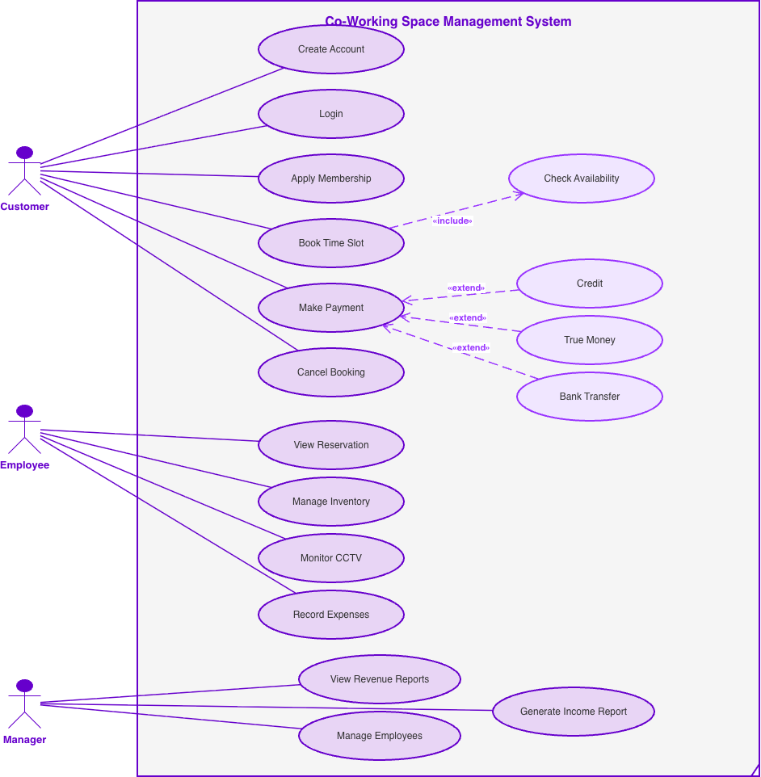

# Emerald D1 — Design Models and Design Rationale

## Overview

This document presents the C4 architecture diagrams for SpaceHub, a co-working space management system. Each diagram level zooms into the system to show how the design satisfies the business requirements gathered from the customer interview. The rationale explains the component boundaries, responsibilities, and key interactions.

---

## Level 1: Context Diagram

### Description

The Context Diagram shows SpaceHub as a single system and identifies the three types of users (actors) and two external systems that interact with.

### Actors

| Actor | Interactions | Requirements Addressed |
|-------|-------------|----------------------|
| **Customer** | Register, apply for membership, login, book time slots, make payments, cancel bookings | Account creation with personal details (first name, last name, address, phone), membership selection (day/month/year), desk booking with availability check, payment via three methods, cancellation with 1-day policy |
| **Manager** | Login, view revenue reports, manage employee information | Revenue aggregation per day/month for income reports, add/delete/manage employee accounts with elevated privileges |
| **Employee** | Login, record costs for equipment, view daily bookings | View reservations by date, manage equipment stock, record operational expenses, monitor CCTV |

### External Systems

| System | Purpose | Requirement |
|--------|---------|-------------|
| **Payment System (external, simulated in v1.0)** | Represents the Banking API used for bank transfer payments. In v1.0 no real bank is called: the payment routes mark a bank transfer as successful after a 1.5-second delay, and `POST /api/bank/transfer` is a simulated endpoint inside the same Express server (`server.js`) that returns a fake transaction ID | The system must connect to an external Banking API for bank transfers |
| **CCTV (external, simulated in v1.0)** | Represents the on-site camera system. In v1.0 `GET /api/employee/cctv` returns a hard-coded list of six cameras with online/offline status; no video feed or CCTV hardware is connected | Employees must be able to monitor the co-working space through the CCTV system |

### Design Rationale

The Context Diagram establishes a clear boundary between SpaceHub and its environment. We identified three distinct user roles because the requirements define different privilege levels: customers can only manage their own bookings and payments, employees handle on-site operations (reservations, check-in, inventory, expenses, CCTV), and managers have the highest privileges including employee management and financial reporting. This separation of roles at the context level directly drives the role-based access control (RBAC) implemented throughout the system.

The two external systems (Payment and CCTV) are shown outside the system boundary because they represent third-party integrations. The Banking API is required by the customer for bank transfer payments, and the CCTV system is an existing on-site infrastructure that the software connects to rather than implements. Placing them outside the boundary makes it clear that SpaceHub depends on these services but does not own or control them. In the v1.0 implementation both integrations are simulated inside SpaceHub (see the table above), so the boundary shows the intended production integration rather than a live connection.

---

## Level 2: Container Diagram

### Description

The Container Diagram zooms into the SpaceHub system boundary and shows the major runtime containers: the Web Application (frontend), the API (backend), and the Database.

The Web Application and the API are drawn as separate logical containers, but in the implementation they run in **one Node.js/Express process and ship as one Docker image** (`implementations/Dockerfile`): `server.js` serves the static pages in `public/` with `express.static` and exposes the `/api/*` routes from the same process. The Database (Neon PostgreSQL) is the only container that runs separately.

### Containers

| Container | Technology | Responsibility |
|-----------|-----------|----------------|
| **Web Application** | HTML, JavaScript, CSS (static files served by the same Express process as the API) | Serves the user interface for all three roles. Customers submit registration data, membership applications, booking details, payment information, and cancellation requests. Managers send revenue and employee management requests. Employees view daily bookings. |
| **API** | Node.js / Express (same process and Docker image as the Web Application) | The central backend that handles all business logic: user authentication, booking availability checks, payment processing (bank transfer is simulated), revenue calculations, employee management, and the simulated CCTV camera list. It enforces the 1-day cancellation policy, the 30-minute booking expiry, and role-based access control. |
| **Database** | PostgreSQL (Neon) | Stores all persistent data: user accounts, booking records, payment transactions, revenue data, membership information, employee records, and equipment inventory. Customer PII (name, address, phone) is encrypted at rest using AES-256-GCM (`lib/crypto.js`); AES-256-CBC is kept only to decrypt older records written before the switch. |

### Data Flows

- **Customer to Web Application:** Registration data, membership applications, booking details, payment information, cancellation requests
- **Web Application to Customer:** Booking confirmations, payment status, refund/cancel confirmations
- **Manager to Web Application:** Revenue report requests, employee management requests
- **Employee to Web Application:** View daily bookings
- **Web Application to API:** Booking data, payment requests, revenue calculations
- **API to Database:** Store and retrieve user data, booking data, payment data, revenue data, membership data, employee data
- **API to Payment System:** Payment requests for bank transfers (simulated in v1.0; no external call is made)
- **API to CCTV System:** Security monitoring data retrieval (simulated in v1.0; the API returns a hard-coded camera list)

### Design Rationale

We chose a three-tier architecture (frontend, backend, database) because it cleanly separates concerns and supports the requirement that the system must be a website accessible from any platform (Windows, Mac, Ubuntu). The Web Application container serves static HTML/CSS/JS files, making it cross-platform through any modern browser without requiring platform-specific installations.

The API container centralizes all business logic in one backend service. This decision was made because the requirements specify several cross-cutting rules that must be enforced server-side: the 1-day cancellation policy, the 30-minute booking expiry, role-based access restrictions, and PII encryption. Placing these rules in the API layer rather than the frontend ensures they cannot be bypassed by a malicious client.

The Database is separated as its own container because the requirement to support up to 1 million user records and 1,000 concurrent users demands a dedicated data store with proper indexing. We chose PostgreSQL (via Neon serverless) because it handles concurrent connections efficiently and provides the relational structure needed for complex queries like revenue aggregation across bookings, payments, and expenses.

The external Payment System and CCTV System remain outside the dashed system boundary. In the target design the API would call the Payment System over HTTP (Banking API for bank transfers) and the CCTV System for security monitoring feeds. In v1.0 both are simulated inside the same server: bank transfers succeed after a fixed delay and the CCTV route returns a hard-coded camera list, so no external call is made. These integrations are kept loosely coupled so that switching payment providers or CCTV hardware does not require changes to the core application.

---

## Level 3: Component Diagram

> **Diagram errata.** No editable source of this image is kept in the repository, so the corrections below apply to the diagram as drawn:
>
> - The label "Sending Revenue Data?" is an unfinished placeholder. In the code, payment records are written to the Database by the API, and Generate Report reads payments and expenses from the Database (`/api/manager/revenue`, `/api/manager/report`, `/api/manager/summary`).
> - The label "Stored bookingooking 30 minutes Booking" is a typo for "Stores bookings; unpaid bookings expire after 30 minutes".
> - "Payment Mainframe" is drawn as an external system that writes directly to the Database. In v1.0 there is no external payment system: bank transfer is simulated inside the API, and only the API writes payment records (`INSERT INTO payments` in `server.js`). CCTV is likewise simulated (hard-coded camera list).
> - Components that exist in the code but are missing from the diagram: **Employee Management** (`/api/manager/employees`, create/update/delete), **Expense Recording** (`/api/employee/expenses`), **Reservation View and Check-in** (`/api/employee/reservations`, `/api/employee/checkin`), **Booking Expiry Job** (`lib/expiry.js`, marks unpaid bookings as expired every 60 seconds), **Role Check** middleware (`lib/auth.js`, `requireRole`), and **PII Encryption** (`lib/crypto.js`, AES-256-GCM).

### Description

The Component Diagram zooms into the API container and shows the internal components that implement the business logic.

### Components

| Component | Responsibility | Requirements Addressed |
|-----------|---------------|----------------------|
| **Create Account** | Handles user registration; collects first name, last name, address, phone number; saves to database | Account creation with required personal details |
| **Authentication (Login)** | Verifies user credentials using bcrypt password comparison; returns user role for session | Secure login for all three user roles (customer, employee, manager) |
| **Membership Subscription** | Manages membership plans (day, month, year); integrates with Payment Service for upfront payment | Membership system with three plan types |
| **Booking System** | Checks desk availability by date and time slot; creates reservations; enforces 30-minute expiry for unpaid bookings; handles cancellation with 1-day-before policy | Desk booking with availability check, specify number of desks needed, booking expiry, cancellation policy |
| **Payment Service** | Processes payments via credit card, bank transfer (simulated Banking API in v1.0), and TrueWallet; records payment transactions | Three payment methods required by customer |
| **Inventory Management** | Tracks equipment stock (desks, chairs, extension cords, peripherals); allows employees to read and update inventory levels | Employee requirement to check and manage equipment stock |
| **Generate Report** | Aggregates revenue per day and per month; calculates income minus expenses for profit reports; provides data to the manager | Manager revenue reports and income reports for the co-working space owner |
| **Security System (Monitor CCTV)** | Provides camera status to employees for security monitoring. In v1.0 this is simulated: it returns a hard-coded camera list and does not connect to real CCTV hardware | CCTV monitoring requirement for employees |

### Key Interactions

- **Create Account** saves user data to the Database with PII fields encrypted via AES-256-GCM (legacy AES-256-CBC values can still be decrypted)
- **Booking System** stores bookings in the Database and enforces the 30-minute expiry rule — if payment is not received within 30 minutes, the booking is released for other users
- **Payment Service** simulates the bank transfer (the Payment Mainframe / Banking API is not called in v1.0) and the API stores payment records in the Database
- **Generate Report** reads payments and expenses from the Database to compile revenue and income reports
- **Security System** returns a simulated camera list (no real CCTV connection in v1.0)

### Design Rationale

The components are organized around distinct business capabilities, following the Single Responsibility Principle. Each component maps directly to a group of related requirements:

1. **Account and Authentication are separated** because registration (collecting PII, encrypting it, storing it) is a different concern from login (verifying credentials, determining role). This separation also supports the security requirement: the Create Account component handles encryption of PII at the point of entry, while Authentication focuses purely on credential verification using bcrypt.

2. **Booking System is the most complex component** because it must coordinate multiple requirements: checking availability across dates and desk counts, enforcing the 30-minute payment window (booking expiry), and applying the 1-day cancellation policy. These rules are tightly coupled to each other (e.g., an expired booking frees desks that affect availability), so they belong in a single component rather than being split.

3. **Payment Service is separated from Booking** because payment processing involves external system integration (Banking API, simulated in v1.0) and supports multiple payment methods (credit card, bank transfer, TrueWallet). Isolating it allows the payment logic to change independently — for example, adding a new payment method would only modify this component without affecting the booking flow.

4. **Membership Subscription uses the Payment Service** rather than implementing its own payment logic. This avoids duplicating payment processing code and ensures all financial transactions go through a single component that can be audited and tested consistently.

5. **Generate Report reads from the Database** to aggregate revenue and expenses across all bookings and recorded costs. It is separated from other components because reporting has different access patterns (read-heavy, aggregation queries) compared to the transactional operations of booking and payment.

6. **Inventory Management is its own component** because equipment tracking (stock levels for desks, chairs, extension cords, peripherals) is an operational concern for employees that is independent of the booking and payment flows. This separation means inventory can be updated without affecting reservations.

7. **Security System (CCTV) is isolated** at the boundary of the system because in production it would integrate with external hardware (v1.0 returns simulated camera data). If the CCTV provider changes, only this component needs to be updated. The component provides a simple interface for employees to view camera status without exposing the complexity of the external CCTV protocol.

---

## Use Case Diagram

### Description

The Use Case Diagram shows all the interactions between the three actors (Customer, Employee, Manager) and the Co-Working Space Management System.

### Customer Use Cases

| Use Case | Description |
|----------|-------------|
| **Create Account** | Register a new account with personal details (name, phone, address) |
| **Login** | Authenticate with email and password |
| **Apply Membership** | Subscribe to a membership plan (day/month/year; the plan type is a field of the request, not a separate use case). Rejected if the customer already has an active membership |
| **Book Time Slot** | Reserve desks for a specific date and time slot (requires an active membership). Includes checking desk availability |
| **Make Payment** | Pay for memberships or bookings. Extends to three payment methods: Credit, True Money, and Bank Transfer |
| **Cancel Booking** | Cancel an existing reservation (1-day-before policy) |

### Employee Use Cases

| Use Case | Description |
|----------|-------------|
| **View Reservation** | View all customer reservations by date and perform check-ins |
| **Manage Inventory** | Track and update equipment stock levels (desks, chairs, electronics) |
| **Monitor CCTV** | View security camera feeds from the co-working space |
| **Record Expenses** | Log daily operational expenses for the space |

### Manager Use Cases

| Use Case | Description |
|----------|-------------|
| **View Revenue Reports** | View daily/monthly revenue summaries |
| **Generate Income Report** | Generate the monthly income vs expense report |
| **Manage Employees** | Add, view, and remove employee accounts |

### Relationships

- **Include:** "Book Time Slot" includes "Check Availability" — every booking request checks which desks are free for the chosen date and time slot, and the booking fails if not enough desks are free
- **Extend:** "Make Payment" is extended by three payment method options: Credit (card), True Money (TrueWallet), and Bank Transfer (simulated Banking API in v1.0)
- **Association:** "Generate Income Report" is a separate Manager use case linked directly to the Manager; it is not an «include» of "View Revenue Reports"

---
